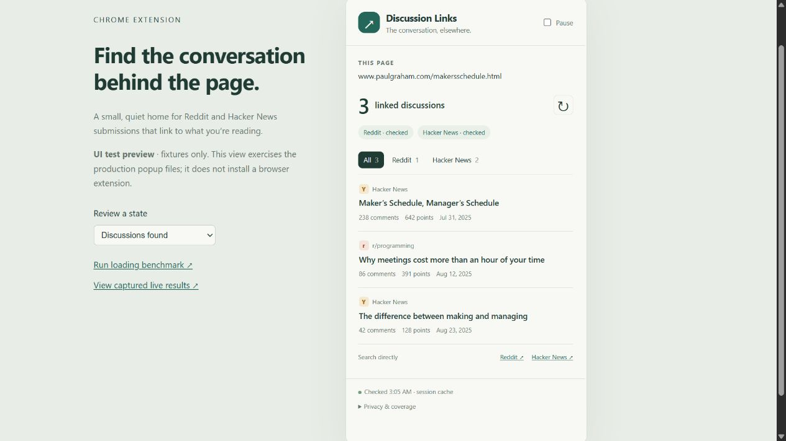

<p align="center"></p>

<p align="center">
  <a href="https://github.com/robertlitz/discussion-links/actions/workflows/ci.yml"></a>
  
  
</p>

# Discussion Links

Find Reddit and Hacker News submissions that link to the webpage you're reading. A toolbar badge shows the number of confirmed matches. Click it to browse the discussions, filter by community, and open the original thread.

The extension uses plain JavaScript and runs its lookups in a Manifest V3 service worker after the active page finishes loading. It has no runtime dependencies, content scripts, page DOM scans, request interception, or polling.

**Current status:** Hacker News discovery has been tested against the live API. Reddit discovery needs approved API access and an OAuth integration; the prototype's anonymous Reddit endpoint returned HTTP 403. Installed-extension testing and installed-versus-disabled performance measurements are still pending. The current build should be treated as a development prototype.

<p align="center"></p>
<p align="center"><em>Popup UI preview with fixture data. This image does not demonstrate installed-extension behavior or approved Reddit access.</em></p>

## Use the prototype

1. Download this repository with **Code > Download ZIP**, or clone it.
2. In Chrome, open `chrome://extensions` and turn on **Developer mode**.
3. Choose **Load unpacked** and select the repository's `extension` folder.
4. Pin **Discussion Links** in the toolbar. Open a public article, wait for it to load, and click the icon.

The source loads directly; Chrome does not need a build step or an npm install. The project is not published in the Chrome Web Store.

The badge displays a confirmed result count, `…` while checking, or `!` if sources are unavailable and no matches have been confirmed. An unavailable source is reported in the popup rather than treated as a successful search with zero results. **Pause** stops automatic checks.

## Keep page work small

Lookups start 350 ms after an active tab reports that loading is complete. A background tab is checked when you activate it. Each URL has one shared lookup, with the two sources searched concurrently. Leaving a tab cancels abandoned work, while another active tab can keep a shared request alive.

| Bound | Value |
|---|---|
| Concurrent URL lookups | 1 |
| Queued URLs | Up to 8 |
| Search pages per source | Up to 2, requesting 100 candidates per page |
| Source deadline | 6 seconds |
| Response size | 512 KB |
| Local session cache | Up to 100 URLs and about 1.5 MB serialized data |
| Freshness | 15 minutes for matches, 5 minutes for empty results |

Warm-cache lookups make no new API requests. Source errors and rate limits trigger backoff. Existing [measurements](docs/validation.md) cover the lookup engine and a local page harness; they do not establish zero impact from an installed extension. Browser and network work still use shared system resources.

## URL matching and privacy

The extension compares destination URLs before counting submissions. It ignores fragments and known tracking parameters, and treats HTTP/HTTPS, `www`, and a trailing slash as equivalent. It preserves functional query parameters and path case. Redirect aliases, canonical tags, comment links, and text-only mentions are outside the current matching implementation.

The prototype sends the cleaned public URL directly to Reddit and HN Algolia. It omits cookies and referrers and uses no analytics or collection server. It skips local hostnames, IP literals, embedded credentials, and recognized secret query parameters. These rules cannot recognize every sensitive public URL; use Pause when needed.

Read the [privacy and permission details](docs/privacy.md) before enabling automatic lookups.

## Reddit API access

The intended initial use is one person's private, non-commercial browsing. This public repository provides source and documentation for review; it is not a commercial service or a public hosted data feed.

Reddit requires approval for Data API access. The intended integration is read-only: search public submissions and show titles, subreddit names, permalinks, scores, comment counts and dates. It will not post, vote, message, moderate, profile accounts, or use Reddit content for model training. The [access plan](docs/reddit-access.md) separates the proposed OAuth integration from the current prototype.

This project is independent of Reddit, Hacker News and Algolia. It has no platform endorsement.

## Develop and verify

Use Node.js 24 or newer. The repository has no npm dependencies.

```sh
npm test
npm run check
npm run package
npm run benchmark
```

`npm test` runs the tests serially. `npm run check` checks JavaScript syntax and the files referenced by the manifest. `npm run package` creates an extension-only ZIP under `dist/`. GitHub Actions runs the source checks and packaging without making live Reddit or HN requests.

For popup review:

```sh
npm run preview
```

The preview prints its PID and exact loopback URL, binds only to `127.0.0.1`, and stops after 20 minutes. Stop it with Ctrl+C when finished. It serves the actual popup files through a fixture-only Chrome API bridge; it does not install an extension. The browser benchmark page runs 30 baseline/lookup pairs with local responses.

See [architecture](docs/architecture.md), [validation and remaining acceptance](docs/validation.md), and [contributing](CONTRIBUTING.md). License selection is pending.
