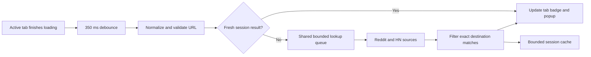

# Architecture

The extension has three production JavaScript modules and a popup. All runtime code is in `extension/`; preview helpers and tests are outside that directory and excluded from the installable ZIP.

## Module responsibilities

`core.js` normalizes URLs, builds search URLs, filters and combines results, and bounds cache data. It preserves path case and functional query parameters while ignoring known tracking fields, fragments and common scheme/host variants.

`lookup.js` serializes URL jobs and searches both sources concurrently. It coalesces matching URL jobs, limits queued work, applies deadlines and response/pagination caps, and backs off after source errors. A job owns an AbortController; the worker cancels it when no active subscriber still needs its result. Intentional cancellation does not trigger network-failure backoff.

`background.js` registers Chrome tab and popup-message listeners. It maintains active-tab state per window, avoids lookups during loading, clears stale navigation state, updates the action badge and title, and stores shared results in session storage. It has no polling loop or keep-alive mechanism.

`popup.js` renders received state with text nodes and safe discussion URLs. It filters the current results and supports Pause. It uses no remote fonts, images or scripts.

## Source behavior

Hacker News uses Algolia's story search restricted to the URL attribute. Reddit currently uses a public JSON search endpoint that was denied in live testing. That endpoint is a prototype integration, not an alternative to approved OAuth access.

Both sources are limited to two result pages per lookup. API search candidates are filtered locally by normalized destination URL. Search indexes, pagination caps, redirects and URL aliases can limit coverage. The count represents confirmed matches returned by these bounded searches, not a complete historical census.

## Runtime lifecycle

Chrome can suspend the Manifest V3 service worker. Results and source cooldowns are restored from session storage when it starts again. In-memory tab state is recreated through navigation, activation and popup requests. Real installed sleep/restart and multiwindow tests remain outstanding.

## Preview separation

`tools/preview.mjs` serves the production popup with `tools/bridge.js`, a fixture-only replacement for the Chrome messaging API. It binds to loopback, logs its PID and stops after 20 minutes. The fixture bridge is not part of the manifest or package. `tools/benchmark-frame.html` measures post-load scheduling in an ordinary page harness; it is not an installed extension.
